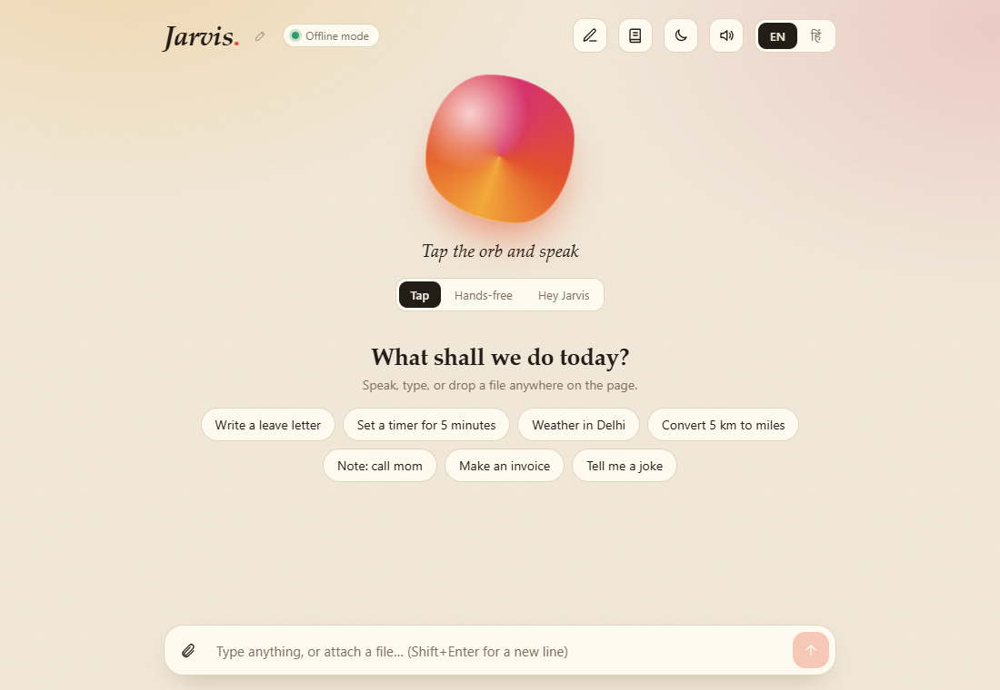

# 1. Product overview

## What Jarvis is

Jarvis is a voice and text assistant for a Windows computer. You talk to it (or type) in **English or Hindi**, and it does the work: it answers questions, opens websites and programs, sets timers, keeps tasks and notes, writes and sends email, makes Word, Excel and PowerPoint files, builds full documents with pictures, and answers questions from your own files.

It runs **on your own computer**. Your documents, contacts, notes and tasks stay in a folder on that computer. It works **without any API key or subscription**. An optional Claude API key makes its written answers fuller, but nothing depends on it.

## Who it is for

- Offices and small businesses that want a private assistant for documents, email and reminders without sending files to a cloud service.
- Hindi and English speakers who want one assistant for both languages.
- Schools, colleges and training centres that want a voice-assistant project to teach with, with source code they can read and extend.
- Developers who want a working base for their own assistant (FastAPI backend, Next.js front end, documented API).

## What you get

| Area | What it does |
|---|---|
| **Voice and text** | Tap to talk, hands-free listening, or a wake word ("Hey Jarvis"). You can interrupt it while it speaks. Everything also works by typing. |
| **Two languages** | English and Hindi for commands, replies and speech. |
| **Your own assistant name** | Say "call yourself Friday" and the wake word, title and replies change. |
| **Everyday help** | Time, date, maths, unit and currency conversion, weather, jokes, coin and dice. |
| **Organiser** | Timers and reminders, to-do tasks, notes. Saved on your computer. |
| **Open and search** | Websites, Notepad, Calculator, Chrome, Command Prompt, Google, YouTube and image search. |
| **Music** | Plays songs from your own music folder (it asks for the folder once, then remembers). Or plays the first matching YouTube video. |
| **Email by talking** | "Send an email to Ravi": Jarvis asks for CC, BCC, subject and message, shows an editable draft, and sends only after you confirm. It keeps an address book of everyone you mention. |
| **Documents from forms** | Leave letter, resignation letter, invoice, budget, meeting minutes, checklist, resume, or your own text as Word, Excel, PowerPoint, CSV, text, Markdown or HTML. |
| **Document studio** | Write whole documents with headings, bold and italic, lists, tables, **pictures with captions**, quotes and page breaks. Save as Word or PDF. |
| **Your files** | Attach a PDF, Word, Excel, PowerPoint or text file: summarise it, list key words, count words, find a word, read it aloud, or convert it. |
| **Chat with your documents** | Point it at a folder or upload files. It indexes them on your computer (ChromaDB) and answers questions with the source file shown. |
| **Safety** | Shutdown and sending email always ask for a yes first. |

The full list of what you can say, with the real replies, is in the [command reference](COMMANDS.md).

## Two ways to run it

| | Offline mode (default) | With a Claude API key (optional) |
|---|---|---|
| Cost | No running cost | You pay Anthropic for what you use |
| Questions it does not know | Wikipedia, then Google | Written answers from Claude |
| Chat with your documents | Quotes the best sentences from your files, with sources | Writes a proper answer from the same passages, with citations |
| Writing new content | Not available (templates and your own text only) | Available |
| Attached images and scanned PDFs | Cannot read them | Can read them |

Everything else is identical in both modes.

## System requirements

| | Requirement |
|---|---|
| Operating system | Windows 10 or 11. Developed and tested on Windows 11. Opening programs and starting songs use Windows features; other systems are not tested. |
| Browser | Google Chrome or Microsoft Edge (needed for voice) |
| Python | Tested with 3.14. Other versions are not tested. |
| Node.js | Tested with 24. Other versions are not tested. |
| Memory and disk | Not measured. Plan for about 8 GB of memory and 3 GB of free disk (the document-search model alone is about 170 MB). |
| Internet | Not needed for most features. Needed for weather, currency, Wikipedia, YouTube, Gmail, and the first download of the document-search model. |
| Microphone | Needed only for voice |

## What Jarvis does not do

Being clear about this up front avoids disappointment:

- It **does not write new content by itself** (essays, long answers) unless you add a Claude API key. Without one it fills templates and arranges the text you give it.
- It **cannot read scanned PDFs or photos** without the optional Claude key.
- It **cannot control any installed program**. It opens a fixed list (Notepad, Calculator, Chrome, Command Prompt) and websites.
- It **cannot stop or pause a song** once your music player has started it.
- PDF files made in the Document studio **cannot contain Hindi text** (Word files can).
- It is built for **one person on one computer**. It has no user accounts or login.
- Voice recognition uses the browser. In Chrome this is done by Google's speech service, so spoken words leave the computer (see [Security and privacy](07-SECURITY-PRIVACY.md)).

More detail is in [Roadmap, limits and release notes](10-ROADMAP-AND-RELEASE-NOTES.md).

## How well it works

193 command checks across 18 areas passed, and 84 automated tests pass. See [Test results](TEST-RESULTS.md) for every line. Voice input and speech output need a real microphone and speakers, so those parts are not covered by the automated checks.
