# 3. User guide

This guide shows how to use Jarvis day to day. For the complete list of things you can say, see the [command reference](COMMANDS.md).

## The screen

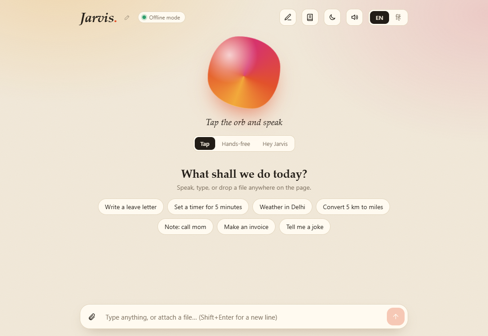

| Part | What it does |
|---|---|
| **Name** (top left) with the pencil | The assistant's name. Click the pencil to rename it. |
| **Offline mode** label | Shows that no AI key is set. Everything still works. It says the model name when a key is set. |
| **Pen icon** | Opens the Document studio. |
| **Book icon** | Opens Documents, where you add files or a folder to chat with. |
| **Moon icon** | Switches between light and dark. Your choice is remembered. |
| **Speaker icon** | Turns Jarvis's spoken replies on or off. |
| **EN / हिं** | Switches the language of commands, replies and speech. |
| **The orb** | Tap it and speak. It changes while Jarvis listens, thinks and speaks. |
| **Tap / Hands-free / Hey Jarvis** | How Jarvis listens (see below). |
| **Text box** | Type any command. Enter sends, Shift+Enter starts a new line. |
| **Paperclip** | Attach a file. You can also drop a file anywhere on the page. |
| **Suggestion buttons** | Ready-made examples on an empty screen. When Jarvis asks a question, short answer buttons appear (for example Yes / No, or numbered choices). |

Dark theme:

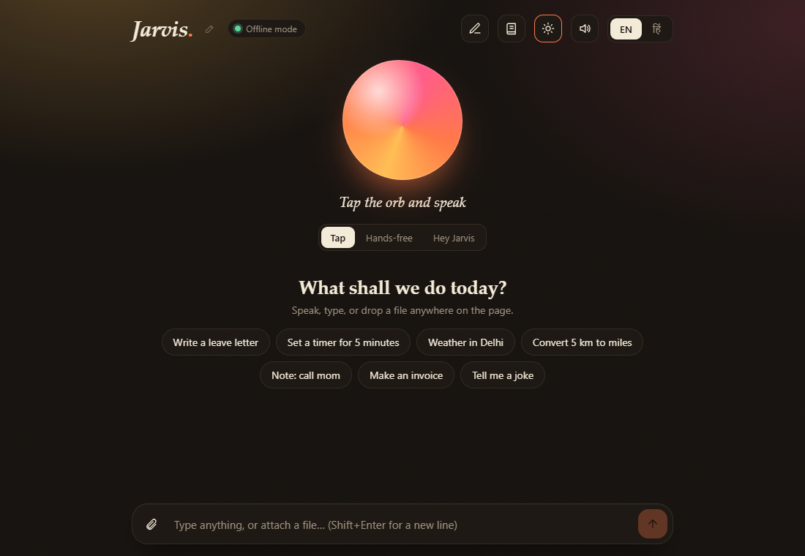

## Three ways to talk

| Mode | How it works | Best for |
|---|---|---|
| **Tap** | Tap the orb, speak, Jarvis answers. | Occasional use. |
| **Hands-free** | Jarvis keeps listening and answers everything it hears. You can talk over it to interrupt. | A quiet room. |
| **Hey Jarvis** | Jarvis waits quietly and reacts only when you say its name. | Like the film: "Hey Jarvis, good morning" or "Send an email, Jarvis". |

In **Hey Jarvis** mode, Jarvis stays awake for about 12 seconds after it answers (25 seconds while it waits for a yes or no), so you can reply without saying the name again. Say "bye" or "sleep" to send it back to waiting. Say only "Jarvis" and it answers "Yes? I'm listening."

Your chosen mode is remembered.

### Change its name

Click the pencil, or say "call yourself Friday" or "change your name to Nova". Hindi: "अपना नाम फ्राइडे रखो". Names can be up to 20 letters or digits. The wake word, the title and the replies all change.

## Everyday help

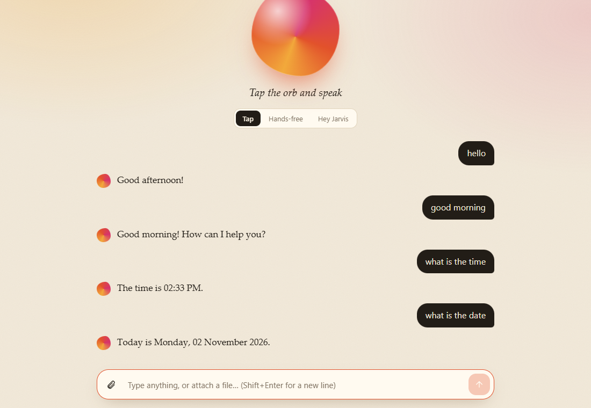

Ask for the time, date, weather in any city, a maths sum, or a conversion ("convert 5 km to miles", "convert 50 usd to inr"). Set timers and reminders ("remind me in 10 minutes to drink water"). Keep tasks and notes ("add task buy milk", "take a note meeting at 5 pm"). They are saved on your computer.

## Open things and play music

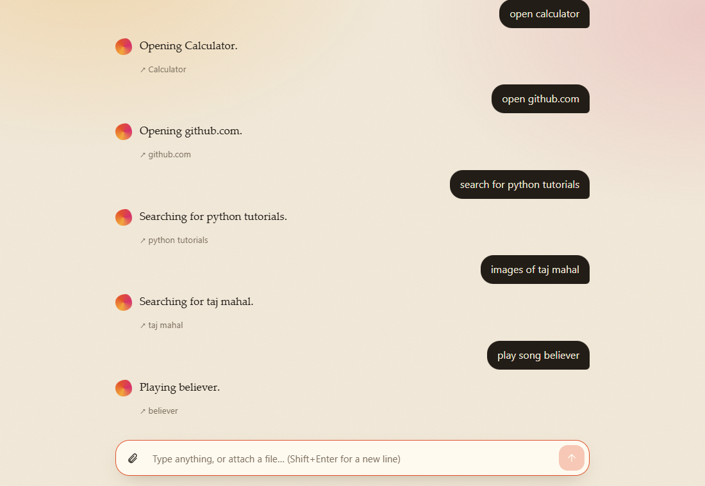

"Open youtube", "open notepad", "open github.com", "search for python tutorials", "images of taj mahal".

**Music from your own folder.** Say "play believer". The first time, Jarvis asks "Where are your songs?" Type the folder, for example `D:\Music`. It saves the folder, finds the song (also inside sub-folders) and starts it in your music player. From then on "play believer" plays straight away. If several songs match, it lists them and you say the number. If the song is not in your folder, it plays the first matching YouTube video instead. Say "skip" at the question to use YouTube always. "Play online believer" always uses YouTube.

## Send an email by talking

Say "send an email to Ravi saying the team meeting is moved to Friday", or just "send an email".

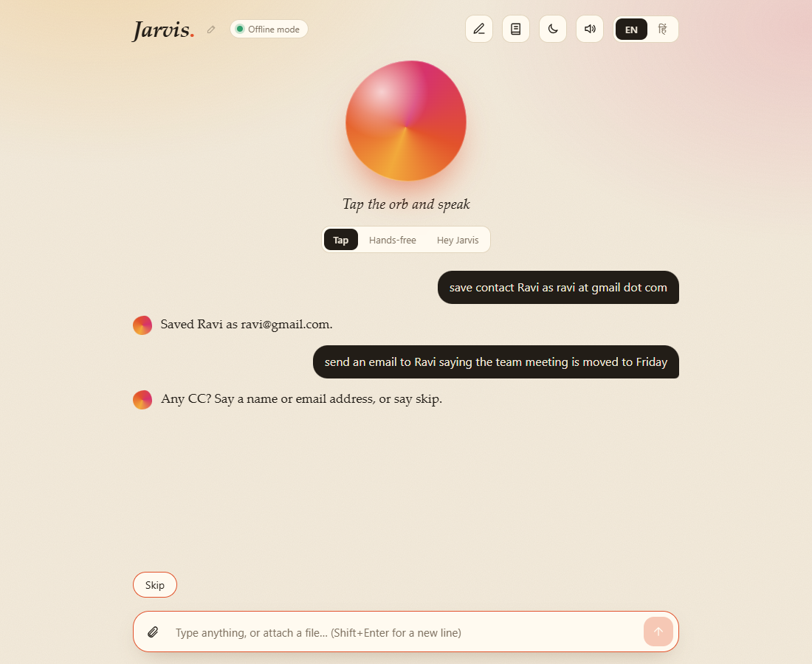

Jarvis asks only for what is missing: who it goes to, then **CC**, **BCC**, **subject** and **message**. Say "skip" for CC, BCC or subject (a skipped subject is written from the first words of your message).

- Say addresses like "ravi at gmail dot com".
- Every address you say is saved to the address book. Next time a name is enough.
- If two saved addresses match a name, Jarvis lists them ("1 ravi@gmail.com, 2 ravi.k@yahoo.com") and you say the number.
- The finished draft appears as a card where **every field can be edited**, then you confirm.

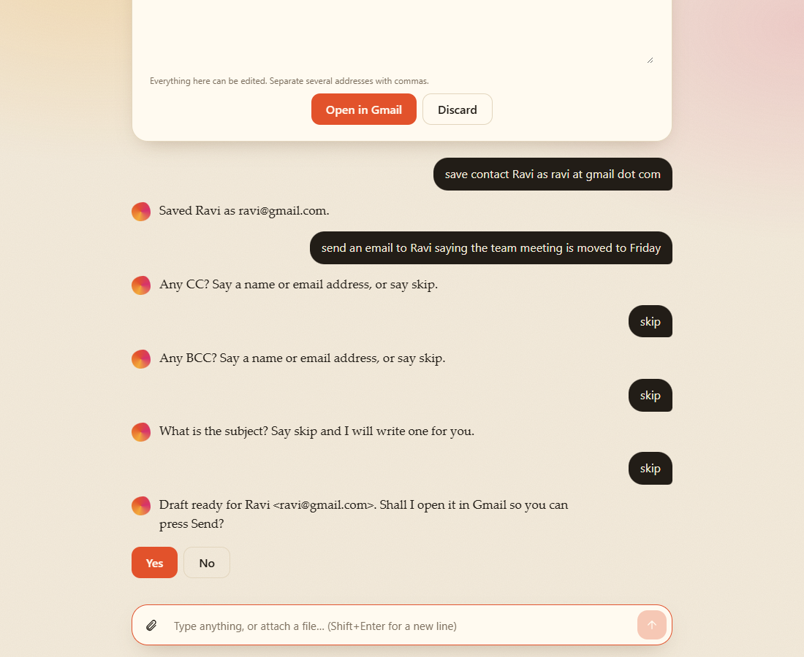

Nothing is sent without your yes. If email is not set up (see [Configuration](04-CONFIGURATION.md)), Jarvis opens a ready-filled Gmail draft and you press Send there.

## Make documents

Say "make a word document", "write a leave letter", "make an invoice", "make a resume", and so on. A form opens. Fill it in and press Create. A download button appears.

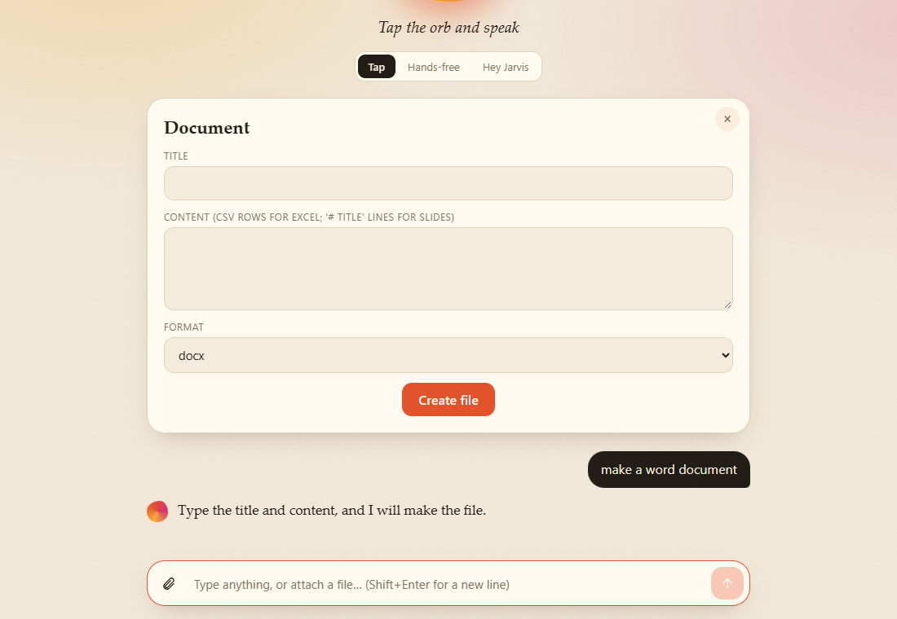

Templates: leave application, resignation letter, invoice (Excel, with totals), budget (Excel), meeting minutes, checklist, resume. Or choose your own text and a format: Word, Excel, PowerPoint, CSV, text, Markdown, HTML.

## Document studio: write a whole document with pictures

Click the **pen icon**, or say "open document studio" or "write a report with images".

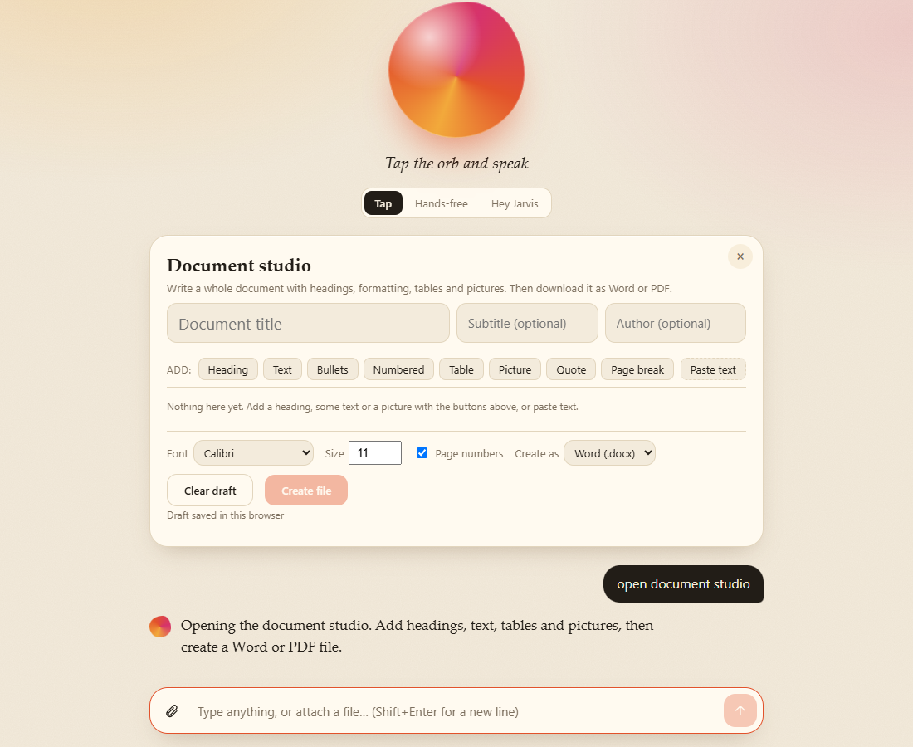

The fastest way to start is **Paste text**. Paste your text using these simple marks and press **Add to document**:

| Write | You get |
|---|---|
| `# Title`, `## Heading` | Headings |
| `**bold**`, `*italic*` | Bold, italic |
| `- item` | Bullets |
| `1. item` | A numbered list |
| `\| a \| b \|` on each row | A table |
| `> text` | A quote |
| `---` | A page break |

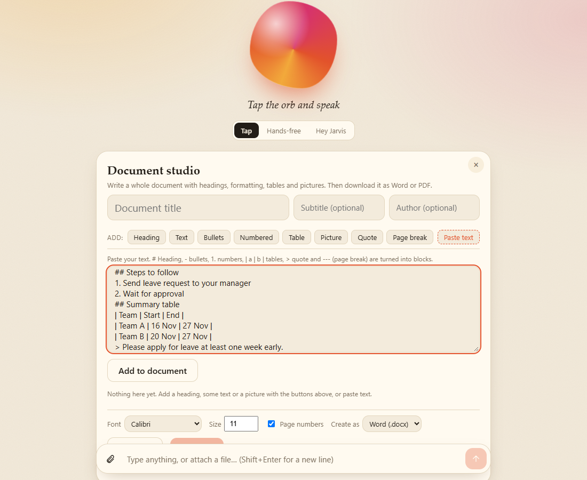

Each block can be edited, moved up or down, or deleted. Add **Picture** blocks with any image file (they are resized automatically, and you set width, alignment and caption).

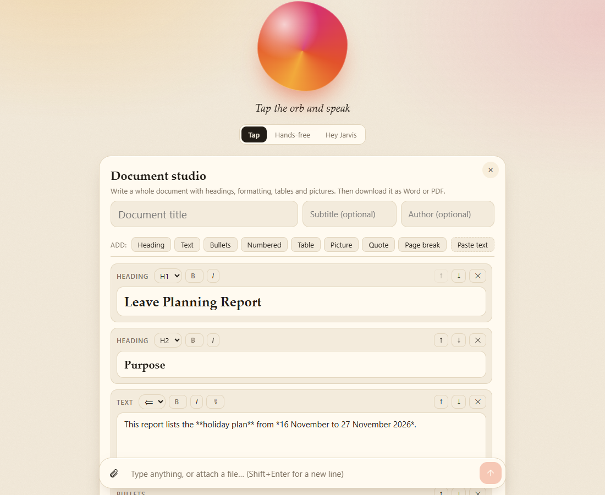

Choose font, size and page numbers, then **Create file** as **Word (.docx)** or **PDF**.

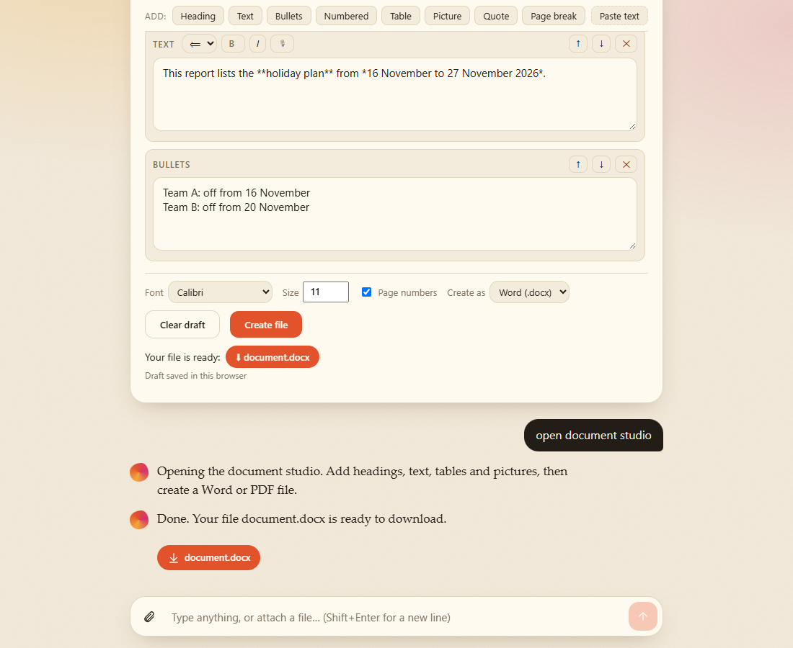

Your draft is saved in the browser, so you can close the panel and come back. Files are also saved in `backend\outputs`. Hindi works in Word. PDF is English only.

## Work on a file you attach

Attach or drop a PDF (with text), Word, Excel, PowerPoint or text file. Then say "summarize it", "key words", "word count", "find budget in the file", "read it", or "convert to Word" (also Excel, CSV, PowerPoint, Markdown, text). The summary picks the most important sentences from the file. It does not rewrite them.

## Chat with your documents

Click the **book icon**. Add files, or type a folder path (for example `D:\Company\Policies`) and press **Index folder**. Jarvis reads every PDF, Word, Excel, PowerPoint, text and code file in it, including sub-folders, and stores the searchable index on your computer.

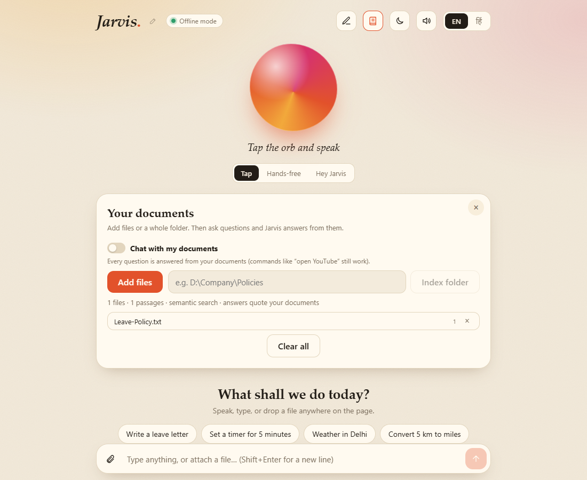

Then say **"chat with my documents"** and ask anything. Jarvis answers from your files and shows which file each sentence came from.

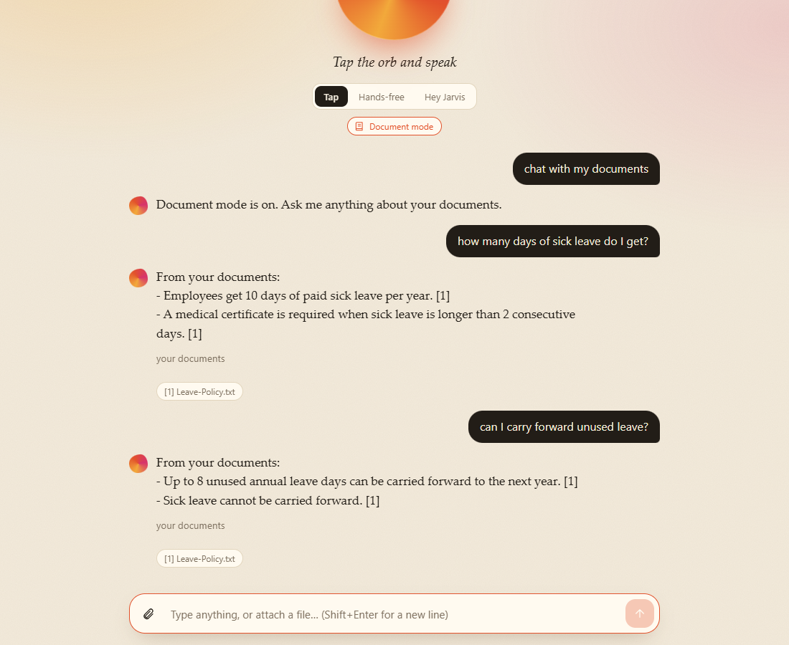

- One question without changing mode: "from my documents, what is the notice period".
- Ask about a topic for a short overview: "explain the leave policy".
- Turn it off: "turn off document mode" or "normal mode".
- Normal commands such as "open youtube" and "what is the time" still work in this mode.

Without an AI key the answer is made of the best matching sentences from your files. It is not rewritten. Scanned PDFs and photos contain no text, so they are skipped.

## Safety

- "Shut down the computer" asks "Do you really want to shut down?" and does nothing until you say yes. After yes you have 30 seconds to say "cancel shutdown".
- Email is never sent without your confirmation.

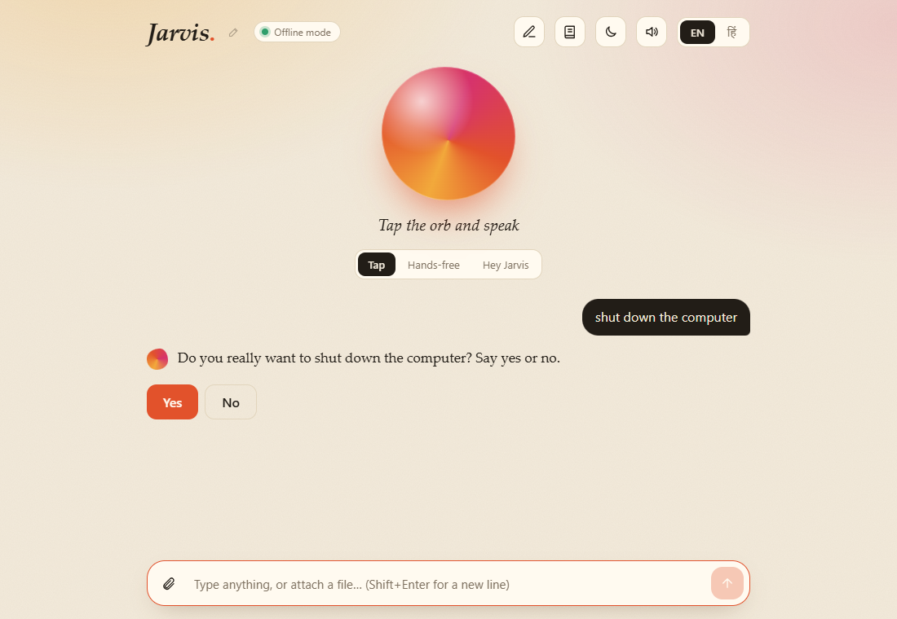

## Hindi

Switch to **हिं** and speak or type Hindi: "नमस्ते", "समय क्या है", "वाराणसी का मौसम", "5 मिनट का टाइमर लगाओ", "यूट्यूब खोलो", "डॉक्यूमेंट स्टूडियो खोलो".

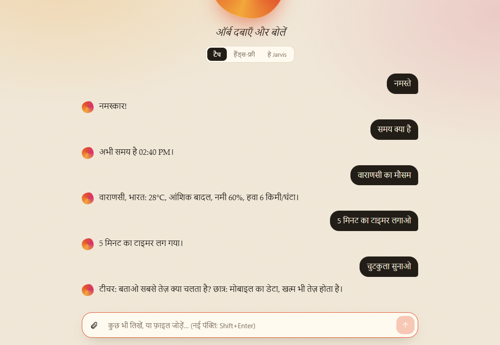

## On a phone-sized screen

The page adapts to narrow screens.

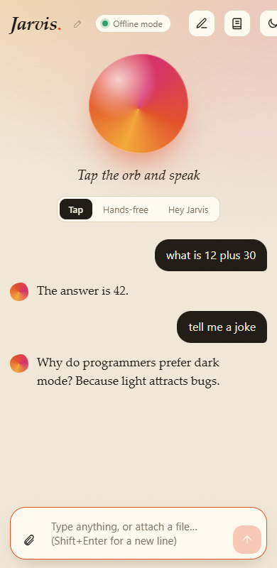
