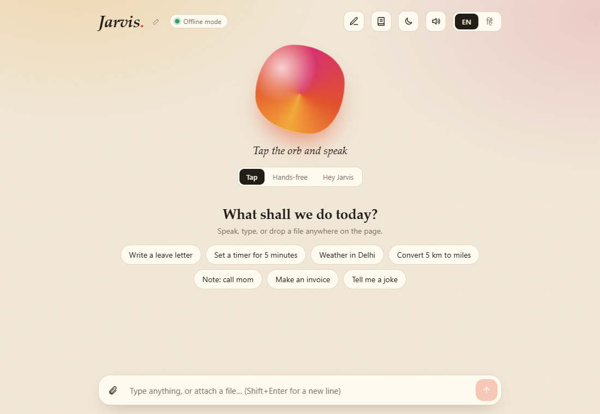

# [PRODUCT NAME]: your private voice assistant for English and Hindi

*Fill in the bracketed parts, then use this page as your one-page brochure. Every claim below is shown in the documentation and in the test results.*

## What it does

Talk or type, in **English or Hindi**. It answers, sets reminders, keeps your tasks and notes, **sends email by voice**, **writes Word and PDF documents with pictures**, **makes Excel and PowerPoint files**, and **answers questions from your own files**, with the source shown.

## Why people choose it

- **No subscription, no API key.** Everyday features work with nothing to sign up for.
- **Private by design.** Your documents, contacts, notes and tasks stay on your computer.
- **Two languages in one assistant.** English and Hindi, by voice or typing.
- **Your own assistant.** Give it any name. "Hey [NAME], good morning."
- **Real documents.** Headings, bold, lists, tables and pictures, saved as Word or PDF.
- **Safe.** It always asks before it shuts the computer down or sends an email.
- **Open and documented.** Clear guides, a documented API, 84 automated tests and 193 command checks that pass.

## Things you can say

| | |
|---|---|
| "What is the time?" "Weather in Varanasi" "Convert 50 USD to INR" | Answers in seconds |
| "Remind me in 10 minutes to drink water" | Timers and reminders |
| "Send an email to Ravi" | Asks CC, BCC, subject and message, then shows an editable draft |
| "Make an invoice" "Write a leave letter" "Make a resume" | Fills in and makes the file |
| "Open document studio" | Write a full document with pictures |
| "Chat with my documents" | Ask questions about your own files |
| "Play believer" | Plays the song from your music folder |

## What you need

Windows 10 or 11, Google Chrome or Microsoft Edge, and a microphone if you want to talk. An internet connection is needed only for weather, currency, Wikipedia and YouTube.

## Optional upgrade

Add your own Claude API key for fuller written answers, writing new content, and reading photos or scanned pages. Not required.

## Price and contact

| | |
|---|---|
| Price | [PRICE AND WHAT IT INCLUDES] |
| Support | [SUPPORT TERMS] |
| Contact | [EMAIL / PHONE / WEBSITE] |
| Licence | [LICENCE TYPE] |

*Not included: control of other programs, support for Mac or Linux, and multi-user accounts. See the product overview for the full list.*
